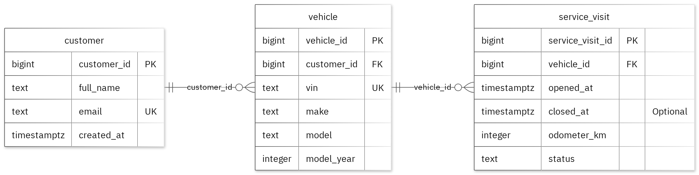

# MIT 8103 Advanced Database Systems

**Automobile Management System** · Joshua Aghedo · Student ID 301835708

## Case study

I focused on Automobile Management System. I once worked in that area and i had a good experience there that is why i picked it as a case study. I built the database to handle service advisors, fleet managers, and customers checking past vehicle repairs. It uses three main tables (customer, vehicle, and service_visit) to cover all the core actions: registering new drivers and cars, managing open and closed service visits, and looking up full service histories by vehicle or customer.

## Portfolio 1: Database Design and Modelling

It was smart for me to split the relational design into three tables, using standard primary keys, foreign keys for relationships, and check constraints for business logic. To make sure a vehicle can't have multiple active visits, I set a partial unique constraint on vehicle_id where status is open. I also documented the normalization process from 1NF up to 3NF. Everything is solid: tested it with 10 invalid inserts and the rules blocked every single one without touching the valid data.

Figure 1. Tables, keys and relationships. PK: primary key; FK: foreign key; UK: unique value.

<!-- PAGE BREAK -->

## Portfolio 2: Query Processing and Optimisation

I ran three SQL queries on our sample data. The join pulled back 2 rows, including Avery Chen with VIN 1HGCM82633A004352. To test index performance, I loaded 20,000 extra rows and adding the index dropped median lookup times from 1.172 ms all the way down to 0.191 ms. Both test runs returned identical records, and the query plan confirmed it used the new index on this setup.

## Portfolio 3: Transactions and Concurrency

I used a temporary counter on service_visit to test COMMIT, ROLLBACK and READ COMMITTED isolation. The uncommitted update remained hidden from the other session, and ROLLBACK restored the earlier committed value. Without locking, two increments left the counter at 2. With SELECT FOR UPDATE, Session B waited for Session A and the final value was 3. The helper is confined to this exercise; the case's original business fields stay unchanged.

## Portfolio 4: NoSQL and Advanced Data Models

I used auto_service_events for the case's event documents. MongoDB inserted 4 sample events and returned the expected results for 4 queries. Validation rejected an invalid date type and a duplicate event ID. Embedded snapshots keep related details with an event, while the details field can differ by event type. These are fictional events; PostgreSQL continues to enforce its relational rules.

## Repository and evidence

https://github.com/joshua-aghedo-5708/Aghedo_Joshua_301835708

The portfolio folders contain the SQL and JavaScript, explanations, query plans, result tables and screenshots.

<!-- PAGE BREAK -->

## Portfolio 5: Distributed and Cloud Database Exercise

I proposed three MongoDB replica members across separate failure zones. The discussion covers primary elections, majority acknowledgement, secondary lag and sharding trade-offs for auto_service_events. Replication supports availability, while backups address recovery. PostgreSQL needs its own availability plan. This is the permitted discussion option; no live replica set or failover test was deployed.

## Individual reflection

I kept customer, vehicle, service_visit in separate tables so their details could be maintained without repeating them in every related record. At most one service visit per vehicle may have status open; enforce with a partial unique constraint on vehicle_id for rows whose status is open. The constraint tests check this alongside the required values and record links. One issue illustrated by the two-session exercise is that both sessions can read the same value before either update is committed. Locking the row before reading preserves both increments. The index comparison also shows why I need to check the execution plan as well as the final answer: the same result can require different amounts of database work.

## AI-use declaration

GitHub Copilot was used to help me understand the problem statement and the course materials.

## References

- [PostgreSQL: constraints](https://www.postgresql.org/docs/17/ddl-constraints.html)
- [PostgreSQL: EXPLAIN](https://www.postgresql.org/docs/17/using-explain.html)
- [PostgreSQL: isolation](https://www.postgresql.org/docs/17/transaction-iso.html)
- [PostgreSQL: row locks](https://www.postgresql.org/docs/17/explicit-locking.html)
- [MongoDB: data modelling](https://www.mongodb.com/docs/manual/data-modeling/)
- [MongoDB: replication](https://www.mongodb.com/docs/manual/replication/)
- [MongoDB: sharding](https://www.mongodb.com/docs/manual/sharding/)
- [Mermaid: ER diagrams](https://mermaid.js.org/syntax/entityRelationshipDiagram.html)

